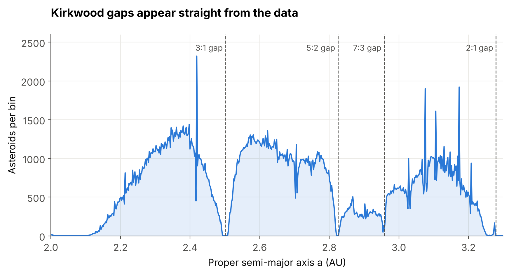
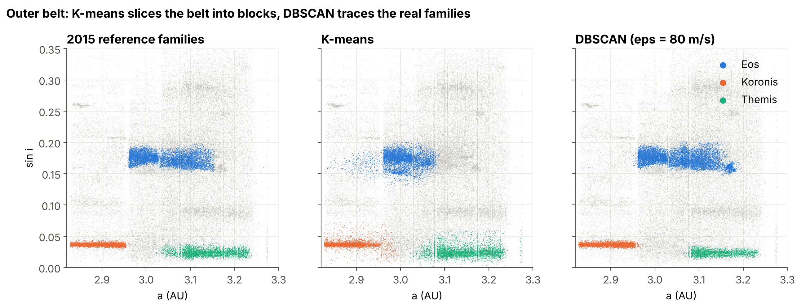

# Mining the Asteroid Belt

**Finding asteroid families in NASA data with data mining and warehousing.**

When two asteroids collide, the fragments stay on very similar orbits for millions of years. These groups are called *asteroid families*. Astronomers find them by clustering asteroids in orbital-element space. This project asks whether a standard data-mining pipeline, with a warehouse, OLAP, clustering and association rules, can find them too, and tests the answer against the official family catalogue.




## Data

One NASA Planetary Data System bundle, [*Nesvorný HCM Asteroid Families V2.0*](https://doi.org/10.26033/5hyq-6k90), used in two roles:

| Role | File | Contents |
|---|---|---|
| **Primary data** (mined) | `proper_catalog24.tab` | 2024 catalogue of proper (long-term) orbits for 1,249,051 asteroids |
| **Reference labels** (never a clustering feature) | `families_2015/*.tab` | 2015 family memberships: 119 lists, 143,711 label rows |

The data is not included in this repo. See [`data/README.md`](data/README.md) for the download.

## Pipeline

```
Extract -> Transform -> Load (star schema in DuckDB) -> OLAP -> Mining -> Evaluation
                                                                 |- K-means
                                                                 |- DBSCAN
                                                                 |- Apriori rules
                                                                 '- outlier scoring
```

- **Preprocessing:** 1,249,051 rows -> 622,886 numbered -> 389,667 within the 2015 label population -> **382,730** main-belt asteroids (2.0-3.3 AU). The labels are joined with a LEFT JOIN, giving 135,583 family members and 247,147 unassigned asteroids (65%).
- **Warehouse:** a star schema in DuckDB. `fact_asteroid` has one row per asteroid and the additive measure `asteroid_count`. It links to four dimensions: `dim_location` (0.02 AU bin -> zone -> belt), `dim_family`, `dim_inclination` and `dim_size` (from absolute magnitude H, which is only a proxy for size).
- **OLAP:** roll-up, drill-down, slice, dice and pivot. The drill-down shows the 7:3 Kirkwood gap at 2.94-2.96 AU.
- **Distance:** features are scaled so that Euclidean distance approximates the standard HCM velocity metric in m/s. This was checked on 400,000 neighbour pairs per zone: median ratio 0.997-0.998.
- **Clustering:** K-means and DBSCAN (eps = 80 m/s, min_samples = 20) run separately on the inner, middle and outer belt.

## Results

| Zone | K-means ARI | DBSCAN ARI | DBSCAN precision | DBSCAN recall | Conditional ARI |
|---|---|---|---|---|---|
| Inner | 0.07 | **0.64** | 0.93 | 0.77 | 0.74 |
| Middle | 0.01 | **0.61** | 0.73 | 0.75 | 0.86 |
| Outer | 0.03 | **0.65** | 0.86 | 0.76 | 0.90 |

- **DBSCAN recovers 10 of the 14 large families** (2,000 or more members) at Jaccard > 0.5. The result is the same at a 0.4 threshold, 9 of 14 at 0.6, and 10 with one-to-one matching. Flora, Maria and Euphrosyne are too spread out and become noise. Massalia merges with its neighbour Nysa-Polana.
- **K-means fails** because it has no noise option and must place the 65% unassigned majority in clusters. Run on reference-family members only, it reaches ARI 0.39-0.66.
- **Conditional ARI** is computed only on reference-family members that DBSCAN put in a non-noise cluster. Agreement is higher there, so most of the disagreement comes from members that DBSCAN leaves as noise.
- **Association rules** (Apriori, support >= 3%, confidence >= 50%) produced 78 rules. Example: inner zone + low inclination + moderate eccentricity -> family member (support 8.1%, confidence 56.5%, lift 1.60).
- **Outliers:** 99 candidate interlopers flagged in the Eos family using its size-dependent V-shape.



## Caveats

- The 2015 labels are never clustering features, but they shape the study in six places: the OLAP Family dimension, one association-rule item, K-means' k (16 / 44 / 41), DBSCAN tuning on the outer belt, the K-means diagnostic that removes unassigned asteroids, and the evaluation.
- DBSCAN was tuned on the outer belt only. The inner and middle belts are **transfer tests** using the same setting, not independent optimisation.
- DBSCAN noise means "not in a dense group at this setting", not confirmed background. Asteroids without a 2015 label are *unassigned*, not proven non-members.
- 119 family lists become 109 after merging 10 nested sub-families. 98 have members in our data: Hilda, Schubart and six Trojan families are not in the main-belt catalogue, and Hungaria, Sylvia and Ulla lie outside 2.0-3.3 AU. The notebook prints this check.

## How to run

Requires Python 3.11 or newer.

```bash
git clone https://github.com/anirban-3204/mining-the-asteroid-belt.git
cd mining-the-asteroid-belt
python -m venv .venv
source .venv/bin/activate          # Windows: .venv\Scripts\activate
pip install -r requirements.txt
# download and unzip the dataset into data/ (see data/README.md)
jupyter lab asteroid_families_dmw.ipynb
```

The full notebook runs in under a minute in our tests. It was checked with Python 3.11 and 3.13, from the minimum versions in `requirements.txt` up to current releases, and gives identical results. Figures are written to `figures/`.

## Repository layout

```
asteroid_families_dmw.ipynb   the full analysis, with outputs
figures/                      plots saved by the notebook
data/README.md                where to get the data
requirements.txt
```

## References

- Nesvorný, D. (2024). *Nesvorný HCM Asteroid Families V2.0*. NASA Planetary Data System. doi:10.26033/5hyq-6k90
- Nesvorný, D., Roig, F., Vokrouhlický, D., & Brož, M. (2024). Catalog of proper orbits for 1.25 million main belt asteroids and discovery of 136 new collisional families. arXiv:2407.18221
- Nesvorný, D., Brož, M., & Carruba, V. (2015). Identification and dynamical properties of asteroid families. In *Asteroids IV* (pp. 297-321). University of Arizona Press.
- Zappalà, V., Cellino, A., Farinella, P., & Knežević, Z. (1990). Asteroid families. I. Identification by hierarchical clustering and reliability assessment. *The Astronomical Journal*, 100, 2030-2046.
- Ester, M., Kriegel, H.-P., Sander, J., & Xu, X. (1996). A density-based algorithm for discovering clusters in large spatial databases with noise. *Proc. KDD-96*, 226-231.
- Agrawal, R., & Srikant, R. (1994). Fast algorithms for mining association rules. *Proc. VLDB*, 487-499.
- Hubert, L., & Arabie, P. (1985). Comparing partitions. *Journal of Classification*, 2, 193-218.

## License

Code is released under the MIT License (see `LICENSE`). The dataset belongs to its authors and NASA PDS and is not redistributed here.
